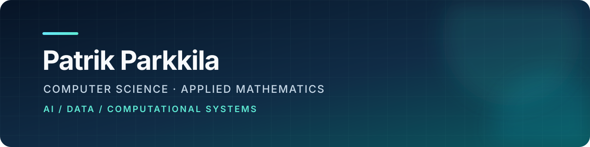

<p align="center">
  
</p>

I am a **Computer Science and Mathematics student at NC State** interested in the space where applied AI, data, and mathematical modeling meet. I enjoy turning research questions into clear, usable systems—from numerical optimization experiments to full-stack AI products.

### Selected work

| Project | What I built | Technologies |
| --- | --- | --- |
| **[Glue4Glu](https://github.com/PParkkila/glue4glu)** | An explainable wearable-data research platform for exploring metabolic-health patterns. Awarded **2nd Place in the Applied AI Databricks track at WolfHacks 2026**. [Demo](https://www.youtube.com/watch?v=gFUiAyoaX4A) · [Devpost](https://devpost.com/software/glue4glu) | Python, FastAPI, Next.js, Databricks, Tiger Data |
| **[ShapeBattle](https://github.com/PParkkila/ShapeBattle)** | An EEG-powered rock-paper-scissors game co-built for **NeuroTech 2026 at NC State**. It extends my wearable-signal work into real-time interaction with a decoder that learns from player corrections. | JavaScript, Web Serial, NeuroPawn, Python |
| **[Trend Filtering](https://github.com/PParkkila/MA402-FinalProject)** | A PETSc TAO implementation of least-squares trend filtering with L1 dictionary regularization, explored through atmospheric CO2 and market data. | Python, PETSc, Jupyter |
| **[TravelPlanner](https://github.com/PParkkila/TravelPlanner)** | A multi-agent travel-planning system that coordinates specialized agents around user preferences and activities. | Python, PydanticAI, Llama |
| **[Reynsla](https://github.com/PParkkila/ReynslaApp)** | An iOS experience designed to encourage time in nature through an interactive reward system. | Swift, SwiftUI |

### Current focus

- Exploring wearable and metabolic-health data through applied research
- Studying autonomous behavior and decision-making through game AI
- Deepening my work in numerical optimization and scientific computing

### Toolbox

```text
Languages     Python · C++ · Java · Swift
AI & data     Databricks · Jupyter · PydanticAI · Tiger Data
Product       FastAPI · Next.js · SwiftUI
Computing     PETSc · Git · REST APIs
```

I am especially interested in **applied AI, research engineering, data science, and mathematical computing**.
